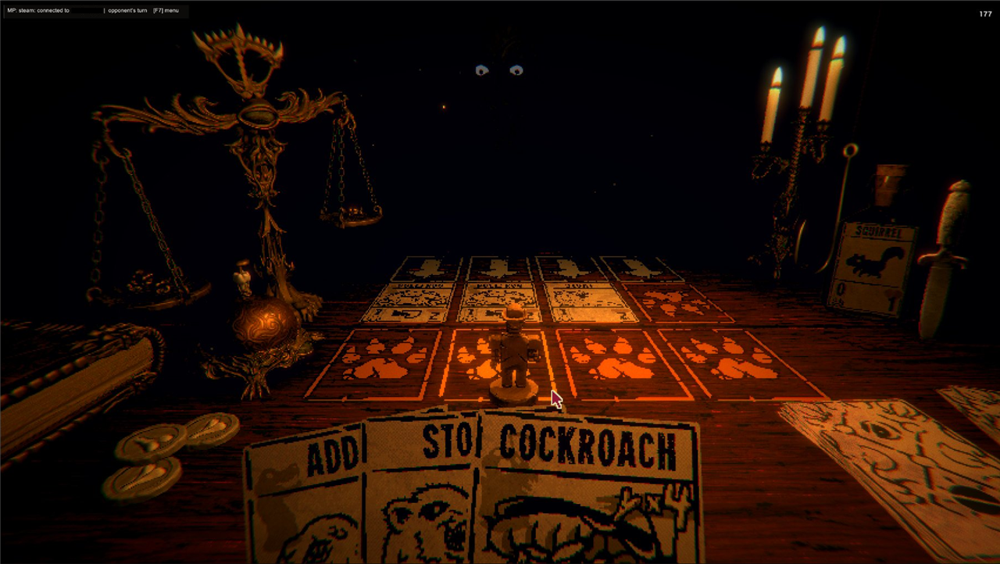
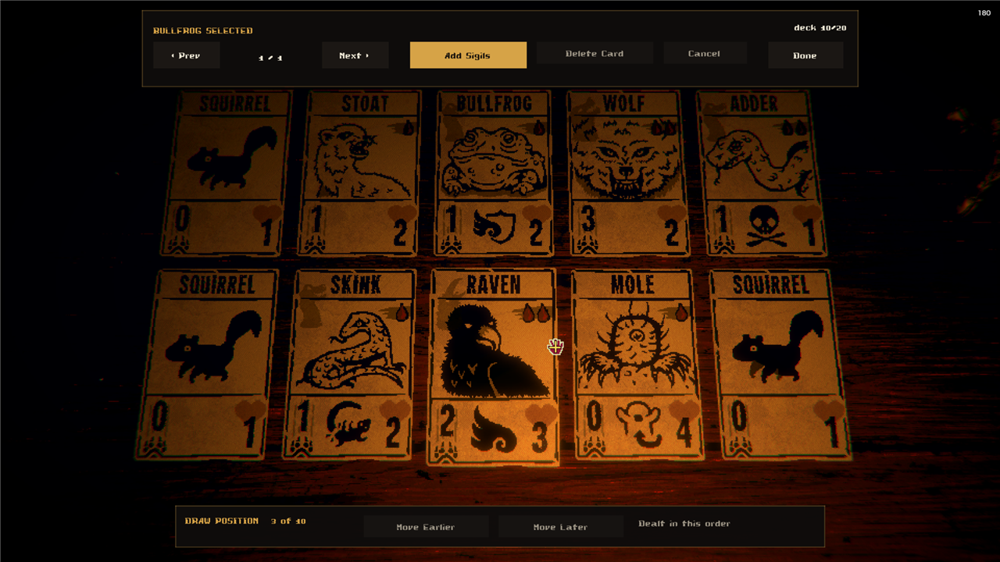

# Inscryption Online

Networked player-versus-player for Inscryption, running **inside the real game client**.

Everything that existed before this was either local hotseat, a Tabletop Simulator
table, or a browser/Godot reimplementation of the card game. This is the actual game,
over the network, against another person.


*A match between two players - the opponent's board, turn indicator, and your hand.*


*Deck building uses the game's own card table.*

## What works

- **All three acts.** Play on Leshy's table, the GBC pixel game, or P03's board. The
  host picks; both clients load the same act. Each act keeps its own deck.
- **Steam lobbies and P2P** — host, browse, join. No IPs, no port forwarding, no
  master server. Verified across two machines on two Steam accounts.
- **Direct IP / LAN** as a fallback for non-Steam copies.
- **Standalone versus mode** launched from the main menu. No campaign run required, no
  map node consumed, and saving is disabled for the duration so a match can never touch
  your save.
- **Real turn order** with a turn indicator; cards appear on the opponent's board as
  they are played.
- **Authoritative board sync** each turn, carrying each card's attack, health and any
  sigils it has picked up — so a buffed or damaged card reads the same on both screens.
- **Nine match rules**, set by the host and played by both: card draw (random or in deck
  order), damage to win, starting hand, draws a turn, deck size, sigils a card, side pile,
  who goes first, and starting bones. Default is always one click away.
- **A lobby.** Both players by name with their own ready state; the match starts the moment
  it reads 2/2. In a match the top of the screen carries the score: both names, both leads,
  and whose turn it is.
- **Chat** in the corner of the screen, and fixed phrases on the number keys during a match.
- **Deck builder** using the game's own 3D card table, paged, persisted to disk — one
  deck per act, each restricted to cards that act can actually draw and pay for. The deck
  has an order you can set, which is the order it is dealt in under the in-order rule.
- **Random decks.** One button builds a legal deck from that act's ordinary card pool. It
  follows the live deck-size rule, including the host's rule when you are the guest, and
  can be turned down to a shorter deck before it is made.
- **Sigils on your own cards.** Put extra sigils on any card in your deck. The
  picker shows that card wearing each sigil, so you choose by looking at cards rather than
  reading a list, and only sigils the act can actually draw are offered.
- **A multiplayer card on the title screen** — drag it into the slot to open the menu,
  alongside New Game and the rest.
- **Clean match end** on both clients, back to the main menu with the result and a short
  summary: rounds, time, the final scales and how many cards each side played.
- **Deck codes.** Copy your deck as one line of text, paste a friend's in.

## Install

1. Steam → Library → right-click **Inscryption** → Manage → **Browse local files**
2. Extract `InscryptionMP-install.zip` into that folder, next to `Inscryption.exe`:
   ```
   Inscryption.exe
   winhttp.dll
   doorstop_config.ini
   BepInEx/plugins/InscryptionMP.dll
   ```
3. Launch the game and press **F7**. Press **F9** at any time to hide or show the small
   status panel in the corner.

**Version compatibility.** Both players need **2.0 or newer**. 2.0 changed how each client
runs combat, not just what the two say to each other, so it can't sit down with 1.x: the
scales, owner-only sigils and resource-counting cards would all go back out of step. An older
peer is turned away at the handshake with a message naming both versions, before anything
loads. Within 1.x the old rules still hold: 1.1–1.5 play each other, newest features off.

## Playing

1. One player clicks **Host Lobby**, the other clicks **Find Games** and picks the lobby.
   The list keeps itself up to date while it is open, a lobby with two people in it stops
   being offered to anyone else, and picking one sets your act vote to the act it advertises.
2. Both players pick an **act**. The tally under the buttons says who wants what; the
   match can only be the one you both chose, and each of you plays your own deck for it.
3. The host sets the **match rules**, on their own screen. Nine of them; both of you play
   under the same set, and the other player can read them before agreeing. Changing one
   takes both players out of ready, so nobody starts a match under rules they didn't see.
4. Both players press **READY**. The first press commits you and says so — `1/2` — and the
   match starts once the second one lands. Pressing again takes it back.
5. Whoever the rules say takes the first turn. Ring the bell to pass, or press **END TURN**
   under the score at the top of the screen.

**F7** menu · **F8** ready up · **F9** hide/show status · **F12** abort out of anything · **1-6** say something in a
match · chat lives in the bottom right corner

## Deck building

**F7 → EDIT DECK.** Browse all cards and click to add. In **View My Deck**, clicking a
card selects it — the bar then offers **Add Sigils** or **Delete Card**, and a strip along
the bottom shows where it sits in the deck with **Move Earlier** and **Move Later**. Decks
are 6–20 cards, stored per act in `BepInEx/config/inscryptionmp-deck-act1.txt` (and `-act2`,
`-act3`), one card per line as `CardName` or `CardName:Sigil,Sigil`. The file's order is the
deck's order, so it can be rearranged in a text editor too.

**Random deck.** The **Random deck** row starts at the deck limit in the rules that apply
right now — the host's rule when you have joined a lobby — and its arrows can make a deck
as small as six cards. **Make deck** chooses from the same pool shown by the card table,
so every generated card is legal for the selected act. It keeps the deck it replaced as
`...txt.before-random`. **Random sigils** leaves the deck plain with **Off**, gives some
cards one extra legal sigil with **Light**, or fills every card's remaining sigil slots
with **Wild**. Printed sigils count towards the same limit and are never repeated.

**Sharing a deck.** In **F7 → EDIT DECK**, **Copy deck code** puts the deck on your
clipboard as one line starting `IODECK1-`, sigils and order included. Paste it anywhere.
Your friend copies it and presses **Paste deck code**. That switches them to the deck's act
and replaces that act's deck, keeping the old one as `...txt.before-import` next to it.
Cards their act can't use are left out, and the panel says how many.

**The second pile.** Act 1 keeps ten squirrels beside your deck and Act 3 ten empty vessels,
and you can draw from either one on any turn instead of your own deck — the same as the
campaign, and the reason a deck full of blood costs is playable at all. Both players get the
same pile: the campaign turns Act 1's squirrels into bees once you have found the figurine,
and a 1/1 flier against a 0/1 squirrel is not a difference two people should discover halfway
through a match. Squirrels can also go in the deck proper, which is what the starter deck's
three are.

**Sigils.** A card may show two in total, its own included — a card printed with one
takes one more. Chosen from what the game itself considers graftable: Act 1 and 2 offer
Leshy's totem set, Act 3 offers P03's. Two is the engine's limit rather than a balance
decision — Act 2 keeps one icon layout per sigil count, and a card carrying more than the
layouts cover draws none at all.

Each act offers the cards that belong to it: Leshy's creatures in Act 1, all four
scrybes in Act 2's GBC game, P03's machines in Act 3. Cards an act can't pay for are
left out, so an Act 1 deck can't smuggle in energy costs. Act 2 and Act 3 cards are
drawn on Act 1's table while you browse, so their pixel art appears a little blocky
there — in a match they render natively.

Each player brings their own deck. Decks are never synchronised — the peer only ever
resolves a card *name* through the game's own card table. A name it doesn't know is skipped
with a line in the log, rather than being trusted the way `CardLoader.GetCardByName` trusts
it (see `NOTES.md`).

The card pool ignores campaign progression on purpose: a versus deck shouldn't be gated
behind someone's single-player unlocks.

## FAQ

**How do I end my turn?** Ring the bell on the table, the same as in the campaign. If you
can't find it, or the act hides it well, press **END TURN**. It appears under the score at
the top of the screen whenever the bell would answer: on your turn, once you've drawn, and
not while you're placing a card. Both do the same thing.

**What does the score at the top mean?** Each side shows how far ahead that player is and
the post, e.g. `+3 / 10`: three up, ten to win. The post is the host's "damage to win" rule,
5 unless they changed it.

**My opponent can't connect: "needs to update the mod".** One of you is on 1.x. Both need
2.0 or newer, see *Version compatibility* above.

**Something went wrong. Where are the logs?** **F7 → Open log folder** opens the BepInEx
folder. `mp-trace.log` is the mod's own log and `LogOutput.log` is BepInEx's. Attach both
to a bug report, from both players if you can.

**Every match deals me the same opening hand.** Fixed in 2.0: each match now rolls its own
shuffle.

## How it works

Each client runs an ordinary single-player battle in which **it** is the player and the
opponent is driven by the network instead of the AI. A card the peer plays into their
slot N materialises in our opponent slot N. The engine's own combat resolution runs
untouched.

That is the whole trick, and it falls out of `Opponent` being abstract with a virtual
`QueueNewCards()`. It holds for every act, because each act's opponent derives from that
same base — `Part1Opponent`, `PixelOpponent` and `Part3Opponent` are all replaced the
same way.

What differs between acts is everything *around* the battle, and that is where the work
went: Act 1 and Act 3 are explorable scenes with a `GameFlowManager` while Act 2's
`GBC_CardBattle` has none, each act draws from its own deck store, and each renders cards
through a different displayer. Those differences live in `ActInfo.cs` rather than being
special-cased at every call site.

See `NOTES.md` for the engine details and the bugs that cost real time — including the
ones worth knowing before you write an Inscryption mod of your own.

## Not done

- All three acts have been played across two machines and two Steam accounts, and every
  release is now played through again on all three by two clients driving themselves. Act 1
  still has the most human hours on it by a wide margin.
- Each client is authoritative over its own board, which is inherent to peer-to-peer with
  no referee. Play with people you trust: this is built for playing with friends, not for
  competitive or ranked play.
- **No consumable items.** The Pliers, the Dagger and the rest deal damage straight to
  the scales that the other player never hears about, and the Dagger writes to the save
  file's story events. A match carries none until they can be synced properly.
- **More match rules.** The wire format takes as many as we like — it is a key=value
  list an older build skips what it doesn't know from — so this is a place to put ideas.
- Some rarer card effects may not replicate perfectly on the opponent's screen.
  Please report anything that looks wrong.

## Building

```bash
tools/deploy.sh          # build + install into every local copy of the game
tools/test-all.sh        # unit tests, then a real match on each act, start to finish
tools/test-all.sh --quick   # just the build and the wire-format tests
tools/peer.py            # scripted opponent for testing without a second client
```

`test-all.sh` launches two real game clients and has them play each other with nobody at
either keyboard — see `src/Autopilot.cs`, which is inert unless `INSCRYPTIONMP_AUTOPILOT` is
set in the environment. It needs a second copy of the game; the paths are at the top of
`tools/match-test.sh`.

Requires the .NET SDK. BepInEx packages come from `https://nuget.bepinex.dev/v3/index.json`
(see `NuGet.config`) — they are not on nuget.org.

## AI disclosure

Most of this mod's code was written by **Claude Opus 5 and Opus 5.5 (Anthropic)**, working with the
author across a handful of extended sessions: the author drove the design, tested every
build against a second machine, and found a good number of the bugs.

Disclosed per Thunderstore's policy on LLM and AI-generated files
(https://wiki.thunderstore.io/llms-and-ai-generated-files). The same disclosure is
present in the assembly metadata (`AI_Assisted_Creation`, `AI_Model_Vendor`,
`AI_Model`), and every commit in the repository carries a `Co-Authored-By` trailer.
